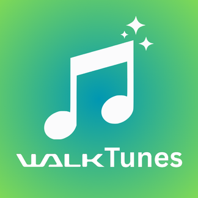

<p align="center">
  
</p>

<h1 align="center">WalkTunes</h1>

<p align="center">
  <b>The companion app classic music players never got.</b><br>
  Offline-first library manager and sync tool for Sony's classic Walkmans<br>
  (NW-ZX300, NW-A series) and, later, any player that mounts as a USB drive.
</p>

<p align="center">
  
  
  
  
  
</p>

<p align="center">
  <a href="docs/USER_GUIDE.md">User Guide</a> ·
  <a href="docs/USER_GUIDE.vi.md">Hướng dẫn tiếng Việt</a> ·
  <a href="docs/DOCS_GUIDE.md">Docs</a> ·
  <a href="docs/ROADMAP.md">Roadmap</a>
</p>

---

> **Status: planning (milestone M0).** The documentation and architecture are
> in place, and code starts next. There is nothing to install yet. Follow
> progress in [STATUS](docs/STATUS.md).

## Why WalkTunes?

Classic Walkmans like the **ZX300** still sound great, last for days on a
charge, and do one thing well. Sony's software support has moved on to
Android Walkmans, and the classic players were left with drag-and-drop
copying: **copy, and that's it.** Nothing remembers what is on the player,
nothing shows what changed, and nothing cleans up.

Streaming made this worse. Your offline music now lives in several places:
CD rips on one laptop, store purchases on another, and tracks that exist on
no streaming service, saved as MP3s from video sites.

WalkTunes brings it together:

- **One library, many folders.** Scan music wherever it lives (internal disks, external drives, NAS). Search with or without Vietnamese diacritics. Find duplicates and broken tags.
- **Real sync.** Pick artists, albums or playlists, **review a dry-run plan**, and copy only the differences. Sync resumes if the cable comes out.
- **Your player remembers.** A small manifest on the player records what was synced and from which computer. Plug it into any of your machines to see what is there and pull back what that machine is missing.
- **Device-aware copies.** Artwork the player can display, formats it can play, filenames it accepts. Your originals are never touched.
- **Tidy rips.** Turn `Artist - Song (Official Video) [HD].mp3` into a properly tagged track, with opt-in MusicBrainz, AcoustID, Cover Art Archive and LRCLIB lyrics.
- **Safe by design.** It never deletes your originals and never removes files it did not put on the player. Every change is logged.

## A square, flat interface

WalkTunes has its own **Tile** design language, inspired by Windows Phone's
Metro style:

- A **Start page of live tiles**: each player shows its free space and the tracks waiting to sync at a glance.
- **Big, light typography** with pivot headers (*albums · artists · tracks*) instead of sidebars.
- **Square and flat**: no rounded corners, no shadows, solid colour blocks, full-bleed album art.
- A true-black dark theme by default, the logo's green-teal as the single accent, **Be Vietnam Pro** type in English and Vietnamese, and **Lucide** icons.

See [STYLE_RULE](docs/STYLE_RULE.md) and [TRANS_ANIMATION](docs/TRANS_ANIMATION.md).

## Supported players

| Tier | Players | Status |
|---|---|---|
| **1. Classic Walkman** | Sony NW-ZX300 (reference device), NW-A30 / A40 / A50, NW-WM1A / WM1Z | Target for 1.0 |
| **2. Older Sony** | Earlier NW-A and NWZ models | After 1.0 |
| **3. Generic players** | No-name USB-drive players, Rockbox devices | After 1.0 |
| **4. MTP players** | Players that don't mount as a drive | Later |

Device behaviour is described in plain data files ([profiles](docs/EXTENSION.md#3-device-profiles)),
so supporting a new player usually needs no code. It needs someone who owns
the player.

## How it's built

WalkTunes is built like a small cloud platform: 19 single-purpose Rust
crates, each with one job, behind one facade.

```
wt-console (GPUI app) ─┐
wt-cli     (wtunes)   ─┴─► wt-sdk ─► wt-sync ─► wt-dock · wt-forge · wt-crawler · wt-enrich
                                               └► wt-ledger (SQLite) · wt-vault (files) · wt-gate (network)
```

- **Rust** end to end, with **GPUI** (from Zed) and **gpui-component** primitives restyled into the Tile look.
- **SQLite** library catalog, **lofty** and **symphonia** for tags and audio, **blake3** hashing, and **ffmpeg** as an optional sidecar for transcoding.
- The CLI (`wtunes`) has full feature parity with the app, so everything is scriptable.

See [ARCHITECTURE](docs/ARCHITECTURE.md) for the service map and design decisions.

## Documentation

Start with **[DOCS_GUIDE](docs/DOCS_GUIDE.md)**. It maps every document and
tells you which docs to update for any code change.

| | |
|---|---|
| **Product** | [PRD](docs/PRD.md) · [ROADMAP](docs/ROADMAP.md) · [STATUS](docs/STATUS.md) |
| **Engineering** | [ARCHITECTURE](docs/ARCHITECTURE.md) · [DATABASE](docs/DATABASE.md) · [ERROR_CONTROL](docs/ERROR_CONTROL.md) · [EXTENSION](docs/EXTENSION.md) · [SECURITY](docs/SECURITY.md) · [OPTIMIZATION](docs/OPTIMIZATION.md) |
| **Craft** | [DEVELOPMENT](docs/DEVELOPMENT.md) · [STYLE_RULE](docs/STYLE_RULE.md) · [TRANS_ANIMATION](docs/TRANS_ANIMATION.md) · [TESTING](docs/TESTING.md) · [UI_TESTS](docs/UI_TESTS.md) · [RELEASE](docs/RELEASE.md) |
| **Users** | [User Guide](docs/USER_GUIDE.md) · [Hướng dẫn sử dụng](docs/USER_GUIDE.vi.md) · [GLOSSARY](docs/GLOSSARY.md) |
| **Logs** | [RESULT](docs/RESULT.md) · [LESSONS](docs/LESSONS.md) |

## Roadmap at a glance

`M0 Foundation` → `M1 Library scan` → `M2 Sync to ZX300` → `M3 Health & device-safe copies`
→ `M4 Desktop app` → `M5 Enrichment & playlists` → `M6 Multi-machine & 1.0` → `M7+ More players`

Details are in [ROADMAP](docs/ROADMAP.md).

## Contributing

The most valuable early contribution is **hardware knowledge**. If you own a
classic Walkman or any other player, you can help verify how it handles
artwork, playlists, lyrics and formats. See the [hardware test script](docs/EXTENSION.md#35-hardware-test-script-per-device).

Read [DEVELOPMENT](docs/DEVELOPMENT.md) before sending code. Please report
security issues privately ([SECURITY](docs/SECURITY.md#8-reporting-a-vulnerability)).

## License

Copyright © 2026 the WalkTunes contributors.

WalkTunes is free software: you can redistribute it and/or modify it under
the terms of the GNU General Public License as published by the Free Software
Foundation, either version 3 of the License, or (at your option) any later
version. See [LICENSE](LICENSE).

Be Vietnam Pro is licensed under the SIL Open Font License 1.1. Lucide icons
are licensed under the ISC License.

## Trademark notice

Sony and Walkman are trademarks of Sony Group Corporation. Windows Phone is a
trademark of Microsoft Corporation. WalkTunes is an independent community
project. It is not affiliated with, endorsed by or sponsored by either
company. Device names are used only to describe compatibility.
