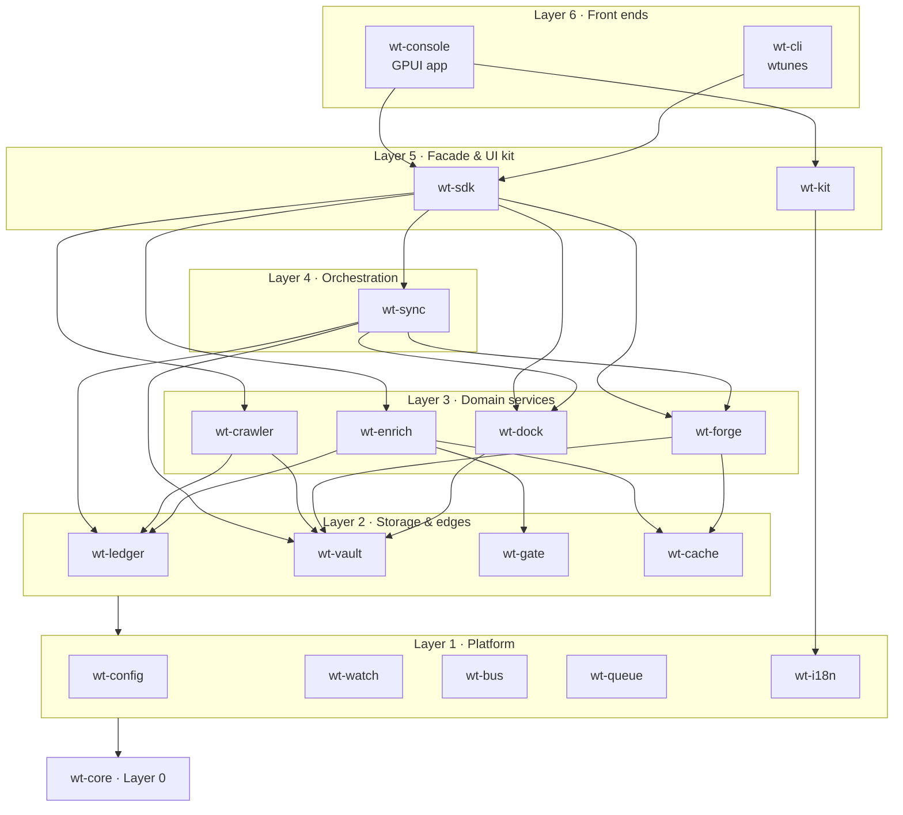
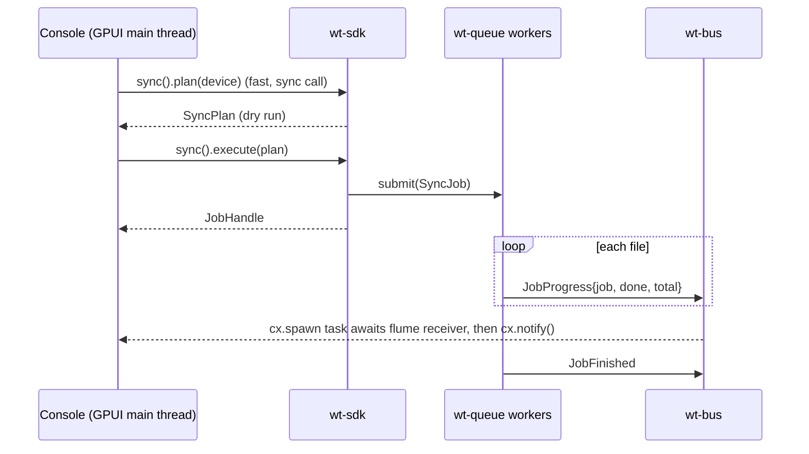
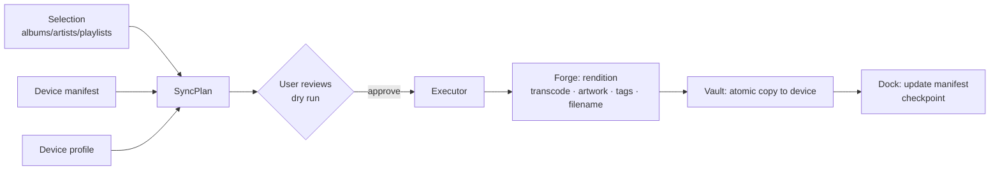

# ARCHITECTURE

| Field | Value |
|---|---|
| Status | Draft (pre-code, M0) |
| Owner | Maintainer |
| Last reviewed | 2026-11-09 |
| Related | [DOCS_GUIDE](DOCS_GUIDE.md) · [DATABASE](DATABASE.md) · [ERROR_CONTROL](ERROR_CONTROL.md) · [EXTENSION](EXTENSION.md) |

---

## 1. Goals that shape the architecture

| Goal | Consequence |
|---|---|
| Users' music must never be lost | Originals are read-only by default; every destructive operation goes through Vault and is logged and reversible (see [SECURITY §3](SECURITY.md#3-data-safety-the-1-risk)) |
| Runs on macOS, Windows and Linux | Pure Rust plus GPUI; no platform-specific code outside `wt-config`, `wt-dock` and packaging |
| Clean, fast UI | GPUI (GPU-rendered) with `gpui-component`; long lists are always virtualized |
| One job per service | A workspace of small crates, a strict layer order, and one facade (`wt-sdk`) |
| Many devices over time | Device behaviour lives in data-driven **profiles**, not in `if model == …` checks |
| UI framework risk is contained | No crate below `wt-kit` may depend on GPUI; the CLI can do everything the GUI can |

---

## 2. Layered view

Dependencies point **downward only**. A crate may depend on any crate in a
lower layer, never on one in the same layer or a higher one, with the
exceptions listed below the diagram.



**Allowed exceptions** (each one is recorded in an ADR):

- `wt-kit` depends on `gpui`, `gpui-component` and `wt-i18n` only. It must
  never depend on domain crates.
- Every crate may depend on `wt-core` and `wt-watch` (for tracing).

`cargo xtask layers` (planned for M0) enforces these rules in CI by
reading `cargo metadata`.

---

## 3. Service catalog

Each entry gives the service's **contract**: what it owns, what it exposes,
and what it must never do.

### 3.0 `wt-core` — shared kernel
- **Owns:** typed IDs (`TrackId`, `FileId`, `RootId`, `DeviceId`, `MachineId`, `JobId`), shared value types (`AudioFormat`, `Duration`, `ContentHash`, `Codec`), the `WtError` trait and `ErrorCode`.
- **Never:** does I/O or depends on anything except `serde`, `thiserror` and `uuid`.

### 3.1 `wt-config` — Parameter Store
- **Owns:** `settings.toml`, per-OS data, cache and log directories (via `directories`), the `MachineId` (a UUID generated once per install).
- **Exposes:** `Config::load()`, typed getters, `Config::update(|c| …)` with validation, and change events.
- **Never:** stores secrets in plain text. The optional AcoustID API key goes into the OS keychain (`keyring` crate).

### 3.2 `wt-watch` — CloudWatch
- **Owns:** `tracing` setup, rotating log files, in-memory metric counters, and `diagnostics bundle` export (logs, config with paths redacted, versions).
- **Never:** sends anything over the network. Telemetry is local only (see [SECURITY §5](SECURITY.md#5-privacy)).

### 3.3 `wt-bus` — EventBridge
- **Owns:** a typed event enum `WtEvent` and a broadcast bus built on `flume` channels. Receivers can be used both sync and async, which GPUI needs.
- **Examples:** `DeviceAttached`, `DeviceDetached`, `ScanProgress`, `JobFinished`, `LibraryChanged{ids}`.
- **Rule:** events are **notifications, not commands**. Nothing may rely on an event being delivered in order to stay correct; the state of record is always in the Ledger.

### 3.4 `wt-queue` — SQS + Step Functions
- **Owns:** a worker pool (std threads, size from config), the `Job` trait, progress reporting, cooperative cancellation (`CancelToken`), retry with backoff for jobs marked retryable, and per-resource locks (for example, one sync per device at a time).
- **Exposes:** `Queue::submit(job) -> JobHandle`, `JobHandle::{progress, cancel, wait}`.
- **Persists:** a job journal in the Ledger (`jobs` table), so interrupted jobs are shown on the next launch.

### 3.5 `wt-i18n` — strings
- **Owns:** Fluent (`.ftl`) resources for `en` and `vi`, locale detection, and the `t!("key")` macro.
- **Rule:** no user-facing string literals in any other crate. Error messages are looked up by error code (see [ERROR_CONTROL](ERROR_CONTROL.md)).

### 3.6 `wt-ledger` — RDS
- **Owns:** the SQLite catalog, migrations and repository types (`TrackRepo`, `FileRepo`, …). Schema: [DATABASE.md](DATABASE.md).
- **Rule:** the only crate that issues SQL. Other crates use repository methods.

### 3.7 `wt-vault` — S3
- **Owns:** library **roots** (folders on a machine), every file read, write, move and delete, atomic writes (temp file, then `fsync`, then rename), the trash (an operation log plus moving files into a holding area instead of deleting them), and content hashing (`blake3`, plus the audio-payload hash; see [DATABASE §4](DATABASE.md#4-track-identity-ladder)).
- **Rule:** **no other crate touches the filesystem for user music.** This is the single choke point for data safety.

### 3.8 `wt-gate` — API Gateway
- **Owns:** the only HTTP client (`ureq`, blocking, rustls), a per-host rate limiter (MusicBrainz: 1 request per second), the user agent `WalkTunes/<ver> (+repo URL)`, offline mode, the per-provider consent check, and response caching via Cache.
- **Rule:** no other crate opens sockets.

### 3.9 `wt-cache` — CloudFront
- **Owns:** a content-addressed disk cache under the OS cache dir (thumbnails, fetched cover art, API responses), with LRU eviction by size, and an in-memory LRU for decoded UI images.
- **Rule:** the cache is always safe to delete. Nothing in it is a source of truth.

### 3.10 `wt-crawler` — Glue Crawler
- **Owns:** walking roots (`walkdir`), reading tags and audio properties (`lofty`), incremental rescans (by mtime + size, then hash), and filesystem watching (`notify`) while the app is open.
- **Emits:** `ScanProgress` and `LibraryChanged`.

### 3.11 `wt-enrich` — Glue Jobs / Lambda
- **Owns:** providers behind the `EnrichProvider` trait: MusicBrainz (metadata), Cover Art Archive, AcoustID (fingerprint via `rusty-chromaprint`), LRCLIB (lyrics), and `FilenameParser` (for untagged downloads, for example YouTube rips).
- **Rule:** never writes to files. It produces **proposals** (`TagProposal`, `ArtworkProposal`) that the user accepts; accepted proposals are applied through Vault.

### 3.12 `wt-forge` — MediaConvert
- **Owns:** renditions, meaning device-specific copies: transcoding through an external `ffmpeg` binary, artwork normalization (baseline JPEG, max size per profile), tag rewriting on the copy, and filename sanitization for FAT/exFAT.
- **Rule:** never modifies originals. Output always goes to a staging folder in Vault.

### 3.13 `wt-dock` — IoT Core
- **Owns:** volume discovery (polling mounted volumes plus OS notifications where available), **pairing** (writing `/.walktunes/device.json`), matching a volume to a `DeviceProfile`, multi-volume devices (internal storage + SD card), and reading and writing the device manifest ([DATABASE §6](DATABASE.md#6-device-manifest)).
- **Profiles:** data files (`profiles/*.toml`) plus an optional Rust hook. See [EXTENSION.md](EXTENSION.md).

### 3.14 `wt-sync` — DataSync
- **Owns:** `SyncPlan` (a pure function of the library selection, the device manifest and the profile, producing a list of `SyncOp`s) and `SyncExecutor` (applies the plan via Forge, Vault and Dock, with checkpoints after every file so it can resume).
- **Directions:** push (library to device), pull (device to this machine's Inbox root), and reconcile (resolve conflicts; see §5.3).
- **Rule:** the plan is always shown, as a dry run, before anything destructive runs. See [SECURITY §3](SECURITY.md#3-data-safety-the-1-risk).

### 3.15 `wt-sdk` — AWS SDK
- **Owns:** the public API used by the Console and the CLI: `Sdk::open()`, `library()`, `devices()`, `sync()`, `health()`, `enrich()`, `jobs()`.
- **Rule:** front ends depend on `wt-sdk` (and `wt-kit`) only. If a front end needs something that is not there, add it to the SDK.

### 3.16 `wt-kit` — Amplify UI
- **Owns:** theme tokens (radius 0, no shadows), Be Vietnam Pro font loading, Lucide icons (through `gpui-component`), wrapped Tile-style components (`WtTile`, `WtPivot`, `WtAppBar`, `WtButton`, `WtTable`, `WtChart`, …), and motion helpers ([TRANS_ANIMATION](TRANS_ANIMATION.md)).

### 3.17 `wt-console` and `wt-cli` — front ends
- **Console:** GPUI windows, views and navigation. Contains no business logic.
- **CLI (`wtunes`):** `clap` subcommands mirroring the SDK, plus `--json` output for scripting.

---

## 4. Runtime model



- **No async runtime in the core** ([ADR-0004](#adr-0004-no-async-runtime-in-core-services)). Services expose blocking APIs. Anything slower than about 16 ms runs as a Queue job.
- The **GPUI main thread** never does I/O. It calls quick SDK getters (Ledger reads under 5 ms; see [OPTIMIZATION](OPTIMIZATION.md)) and submits jobs.
- **SQLite access:** one writer connection owned by a Ledger writer thread, plus a small pool of read connections (WAL mode).

---

## 5. Key flows

### 5.1 Scan
1. Crawler walks a root and compares `(path, size, mtime)` with the `files` table.
2. New or changed files: read tags and properties with `lofty`, then compute `content_hash` (and `audio_hash` lazily, when identity is needed).
3. Upsert `files` and resolve `tracks` using the identity ladder ([DATABASE §4](DATABASE.md#4-track-identity-ladder)).
4. Missing files: mark them `missing_since`. Do not delete rows until the user confirms or after a grace period.

### 5.2 Push sync (library to device)

`SyncOp` kinds: `Add`, `Replace` (newer rendition), `Retag` (tags only, if the profile allows in-place edits), `Remove` (only files that the manifest proves WalkTunes put there), `WritePlaylist`, `WriteLyrics`.

### 5.3 Pull and reconcile (device to machine)
- A file on the device whose manifest entry has `origin_machine != this machine`, and whose track is not in the local Ledger, is offered for **pull** into this machine's *Inbox* root.
- A file on the device with **no manifest entry** (copied by hand or by another tool) is classified as *foreign*. WalkTunes never removes foreign files. It offers to **adopt** them (hash them and add them to the manifest).
- Conflicts (the same track with different tags on the two sides) are resolved by user choice. The default is "keep the library version".

### 5.4 Multi-machine model
Each machine has its own Ledger. The **device is the carrier** that connects
them: its manifest records which machine contributed each file. Optionally,
a root can live on a NAS or a Syncthing-shared folder; identity by hash makes
those files deduplicate naturally. WalkTunes does not implement machine-to-machine
networking ([ADR-0006](#adr-0006-device-manifest-is-a-json-snapshot-not-a-database)).

---

## 6. Workspace layout

```
walktunes/
├── Cargo.toml              # [workspace], shared lints, [workspace.dependencies]
├── crates/
│   ├── wt-core/  wt-config/  wt-watch/  wt-bus/  wt-queue/  wt-i18n/
│   ├── wt-ledger/  wt-vault/  wt-gate/  wt-cache/
│   ├── wt-crawler/  wt-enrich/  wt-forge/  wt-dock/
│   ├── wt-sync/  wt-sdk/  wt-kit/
│   ├── wt-console/         # bin: walktunes
│   └── wt-cli/             # bin: wtunes
├── profiles/               # device profiles (*.toml)
├── assets/
│   ├── fonts/BeVietnamPro-*.ttf  (+ OFL.txt)
│   └── i18n/{en,vi}/*.ftl
├── fixtures/               # generated test media & virtual devices (TESTING.md)
├── xtask/                  # cargo xtask: layers, docs-check, fixtures, bundle
└── docs/
```

---

## 7. Technology choices

| Concern | Choice | Notes |
|---|---|---|
| Language | Rust stable (MSRV pinned in `rust-toolchain.toml`) | Edition 2024 |
| UI | `gpui` (Zed), pinned to a git rev or crates.io version | API is unstable; upgrade deliberately (ADR-0001) |
| Components, icons, charts | `gpui-component` (Longbridge): component primitives, Lucide icon set, chart primitives, restyled to the Tile look | ADR-0002, ADR-0011 |
| Font | Be Vietnam Pro (SIL OFL 1.1), bundled | Full Vietnamese diacritics coverage |
| Tags | `lofty` | Read and write ID3v2, Vorbis comments, MP4, APE |
| Decode / probe | `symphonia` | Duration, bit depth and sample rate when tags lack them; fingerprint input |
| Transcode | external `ffmpeg` (sidecar) | ADR-0008 |
| DB | `rusqlite` (bundled SQLite) + `refinery` or hand-rolled migrations | ADR-0005 |
| Hashing | `blake3` | |
| HTTP | `ureq` + rustls | ADR-0004 |
| Fingerprint | `rusty-chromaprint` | AcoustID-compatible |
| Images | `image` + `fast_image_resize` | Baseline JPEG output |
| CLI | `clap` | |
| Logging | `tracing`, `tracing-subscriber`, `tracing-appender` | |
| i18n | `fluent-bundle` | |
| Errors | `thiserror` in libraries, `anyhow` only in binaries | ERROR_CONTROL |

---

## 8. Platform specifics

| Topic | macOS | Windows | Linux |
|---|---|---|---|
| Volume discovery | `/Volumes/*` + DiskArbitration events (later) | Drive letters + `WM_DEVICECHANGE` (later) | `/proc/self/mountinfo` (`/media`, `/run/media`) + udev (later) |
| Safe eject | `diskutil eject` | `CM_Request_Device_Eject` | `udisksctl unmount/power-off` |
| Hidden metadata on device | `._*` AppleDouble files must be avoided or cleaned | — | — |
| ffmpeg | bundled in the `.app` or Homebrew | bundled `ffmpeg.exe` | system package or bundled in the AppImage |

The first version polls mounted volumes every 2 seconds. That is simple,
works on all three OSes, and is cheap enough. OS notifications are an
optimization for later.

---

## 9. Decision log (ADRs)

Format: **Context → Decision → Consequences**. ADRs are append-only. To
change one, write a new ADR that supersedes it.

#### ADR-0001 Rust + GPUI for the desktop UI
*2026-11-09 · Accepted.* **Context:** we want a native, fast, clean UI on three OSes, with large virtualized lists. **Decision:** use GPUI from Zed. **Consequences:** fast rendering and a modern look, but the API is unstable and the docs are thin. We mitigate this by pinning the version, keeping GPUI inside `wt-kit` and `wt-console`, and keeping a CLI with full feature parity.

#### ADR-0002 `gpui-component` for components, Lucide icons and charts
*2026-11-09 · Accepted (look superseded by ADR-0011).* **Context:** GPUI has very few built-in widgets. The desired look was shadcn/ui with Lucide icons. **Decision:** build `wt-kit` on `gpui-component`, which follows shadcn's design language and ships the Lucide icon set and chart primitives. **Consequences:** a second fast-moving dependency. Wrapping it in `Wt*` components keeps churn out of `wt-console`.

#### ADR-0003 Single-job services with a facade
*2026-11-09 · Accepted.* **Decision:** a Cargo workspace of small crates in strict layers. Front ends use `wt-sdk` only. **Consequences:** more crates and boilerplate, but clear ownership, parallel compilation, and the UI can be replaced without touching the core.

#### ADR-0004 No async runtime in core services
*2026-11-09 · Accepted.* **Context:** GPUI has its own executor. Mixing in tokio adds complexity. Our workload is disk-bound plus low-rate HTTP. **Decision:** core services use blocking APIs, run on `wt-queue` worker threads, use `ureq` for HTTP, and report through `flume` channels. **Consequences:** a simple mental model and easy testing. If we ever need high-concurrency networking, revisit this ADR.

#### ADR-0005 SQLite as the Ledger
*2026-11-09 · Accepted.* `rusqlite` with bundled SQLite, WAL mode, one writer thread. A single file is easy to back up. FTS5 gives library search.

#### ADR-0006 Device manifest is a JSON snapshot, not a database
*2026-11-09 · Accepted.* **Context:** devices are FAT32/exFAT volumes over USB and may be unplugged at any time, and SQLite journals on removable media are fragile. **Decision:** `/.walktunes/manifest.json`, written atomically (write `manifest.json.tmp`, `fsync`, rename) after keeping `manifest.prev.json`, with a monotonically increasing `generation`. **Consequences:** the whole file is rewritten at each checkpoint, which is fine up to about 50k entries ([OPTIMIZATION](OPTIMIZATION.md)). Readers must tolerate unknown fields.

#### ADR-0007 Originals are immutable by default; devices get renditions
*2026-11-09 · Accepted.* Library files are only modified when the user explicitly edits tags or accepts an enrichment proposal. Anything device-specific (resized artwork, transcodes, simplified tags) is produced by Forge on the copy.

#### ADR-0008 ffmpeg as an external sidecar
*2026-11-09 · Accepted.* Run `ffmpeg` as a subprocess instead of linking `libav*`. This gives simpler cross-platform builds and isolates crashes. Transcoding is optional: the app works without ffmpeg, and the features that need it are disabled with a clear message.

#### ADR-0009 License: GPL-3.0-or-later
*2026-11-09 · Accepted.* All dependencies must be GPL-3.0-compatible (MIT, Apache-2.0, BSD, ISC, MPL-2.0, Zlib, OFL for fonts). `cargo-deny` enforces this. See [SECURITY §7](SECURITY.md#7-licenses-and-supply-chain).

#### ADR-0010 Pairing-based device identity
*2026-11-09 · Accepted.* **Context:** USB VID/PID mapping to mount points is unreliable across OSes, and generic players report nothing useful. **Decision:** when the user pairs a volume, WalkTunes writes `/.walktunes/device.json` holding a `device_id` and the profile. Unpaired volumes are matched to a *suggested* profile by heuristics (volume label, folder layout, marker files) and the user confirms. **Consequences:** works for every mass-storage player, including no-name ones.

#### ADR-0011 Tile design language (Metro-inspired)
*2026-11-09 · Accepted. Supersedes the "shadcn look" part of ADR-0002.* **Context:** the maintainer wants a square, flat, typographic UI in the spirit of Windows Phone's Metro: tiles, large light headings, solid colour blocks, no rounded corners. **Decision:** `wt-kit` defines the "Tile" language ([STYLE_RULE Part B](STYLE_RULE.md#part-b--design-system-tile-metro-inspired)): radius 0, no shadows, true-black dark theme by default, a Start page of live tiles, pivot hubs with a bottom app bar, and Metro-like motion approximated in 2D ([TRANS_ANIMATION](TRANS_ANIMATION.md)). `gpui-component` stays as the primitive layer, restyled through its theme and wrapped in `Wt*` components. We are inspired by Metro but never use Microsoft fonts, icons or branding. **Consequences:** more custom components (tile, pivot, app bar) than a stock shadcn look, and every `gpui-component` upgrade must be checked for re-introduced radius or shadows (UI_TESTS checklist).
