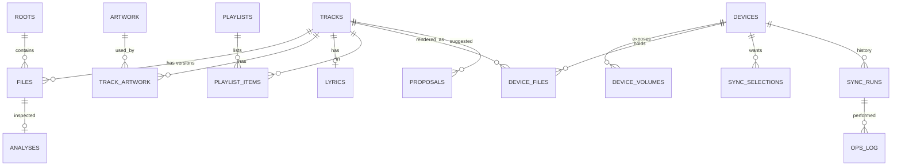

# DATABASE

| Field | Value |
|---|---|
| Status | Draft (schema v1 proposal) |
| Owner | `wt-ledger`, `wt-dock` |
| Last reviewed | 2026-11-09 |
| Related | [ARCHITECTURE §3.6](ARCHITECTURE.md#36-wt-ledger--rds) · [ADR-0005](ARCHITECTURE.md#adr-0005-sqlite-as-the-ledger) · [ADR-0006](ARCHITECTURE.md#adr-0006-device-manifest-is-a-json-snapshot-not-a-database) |

There are three stores, each with a different durability contract:

| Store | Where | Truth for | Format |
|---|---|---|---|
| **Ledger** | `<data_dir>/ledger.db` | Everything this machine knows | SQLite (WAL) |
| **Device manifest** | `<device>/.walktunes/manifest.json` | What WalkTunes put on that device | JSON snapshot |
| **Cache** | `<cache_dir>/` | Nothing (it can be rebuilt) | Content-addressed files |

`<data_dir>` comes from `directories::ProjectDirs("dev", "walktunes", "WalkTunes")`:
for example `~/Library/Application Support/dev.walktunes.WalkTunes/` on
macOS, `%APPDATA%\walktunes\WalkTunes\data\` on Windows, and
`~/.local/share/walktunes/` on Linux.

---

## 1. Core concepts

- **Track:** a *logical recording*, such as "Artist – Song", independent of any file.
- **File:** a *physical audio file* inside a **root** on this machine. One track may have many files (FLAC and MP3 versions, or duplicates).
- **Device file:** a file on a paired device, usually a *rendition* of a library file.
- **Root:** a folder registered in the library. `kind` is `library` (the user's music), `inbox` (where pulls land) or `watch` (scanned but read-only, for example a NAS).



---

## 2. Conventions

- Primary keys are `TEXT` UUIDv7 (sortable by time), except where noted.
- Timestamps are `INTEGER` Unix milliseconds in UTC.
- Paths inside a root or volume are stored **relative**, with `/` separators, NFC-normalized.
- Booleans are `INTEGER` 0/1. Enums are `TEXT` with a `CHECK` constraint.
- Every table has `created_at`. Mutable tables also have `updated_at`.
- Connection pragmas: `journal_mode=WAL`, `synchronous=NORMAL`, `foreign_keys=ON`, `busy_timeout=5000`.

---

## 3. Tables (schema v1)

### 3.1 Identity and places

```sql
CREATE TABLE machines (
  id            TEXT PRIMARY KEY,          -- MachineId
  name          TEXT NOT NULL,             -- hostname or user label
  is_self       INTEGER NOT NULL DEFAULT 0,
  first_seen_at INTEGER NOT NULL
);

CREATE TABLE roots (
  id         TEXT PRIMARY KEY,
  path       TEXT NOT NULL UNIQUE,         -- absolute, OS-native
  kind       TEXT NOT NULL CHECK (kind IN ('library','inbox','watch')),
  enabled    INTEGER NOT NULL DEFAULT 1,
  created_at INTEGER NOT NULL
);
```

### 3.2 Music

```sql
CREATE TABLE tracks (
  id              TEXT PRIMARY KEY,
  title           TEXT,
  artist          TEXT,
  album           TEXT,
  album_artist    TEXT,
  disc_no         INTEGER,
  track_no        INTEGER,
  year            INTEGER,
  genre           TEXT,
  duration_ms     INTEGER,
  mb_recording_id TEXT,                    -- MusicBrainz recording MBID
  mb_release_id   TEXT,
  acoustid        TEXT,
  fingerprint     BLOB,                    -- compressed chromaprint, optional
  identity_level  INTEGER NOT NULL,        -- see §4 (1 = strongest)
  preferred_file  TEXT REFERENCES files(id),
  created_at      INTEGER NOT NULL,
  updated_at      INTEGER NOT NULL
);
CREATE INDEX idx_tracks_mbid ON tracks(mb_recording_id);
CREATE INDEX idx_tracks_album ON tracks(album_artist, album, disc_no, track_no);

CREATE TABLE files (
  id            TEXT PRIMARY KEY,
  track_id      TEXT NOT NULL REFERENCES tracks(id),
  root_id       TEXT NOT NULL REFERENCES roots(id),
  rel_path      TEXT NOT NULL,
  size          INTEGER NOT NULL,
  mtime_ms      INTEGER NOT NULL,
  content_hash  TEXT NOT NULL,             -- blake3 of whole file (hex)
  audio_hash    TEXT,                      -- blake3 of audio payload only (§4)
  container     TEXT NOT NULL,             -- flac, mp3, m4a, wav, aiff, dsf, dff, ogg, opus, ape, wma
  codec         TEXT NOT NULL,             -- flac, mp3, aac, alac, pcm, dsd, vorbis, opus, ...
  lossless      INTEGER NOT NULL,
  sample_rate   INTEGER,
  bit_depth     INTEGER,
  channels      INTEGER,
  bitrate_kbps  INTEGER,
  source_kind   TEXT NOT NULL DEFAULT 'unknown'
                CHECK (source_kind IN ('unknown','cd_rip','store','stream_rip','user_marked')),
  missing_since INTEGER,                   -- set when not found on rescan
  scanned_at    INTEGER NOT NULL,
  created_at    INTEGER NOT NULL,
  UNIQUE (root_id, rel_path)
);
CREATE INDEX idx_files_track ON files(track_id);
CREATE INDEX idx_files_hash  ON files(content_hash);
CREATE INDEX idx_files_audio ON files(audio_hash);

CREATE VIRTUAL TABLE tracks_fts USING fts5(
  title, artist, album, album_artist, genre,
  content='tracks', content_rowid='rowid', tokenize='unicode61 remove_diacritics 2'
);
```

`remove_diacritics 2` means that searching for `son tung` also matches
`Sơn Tùng`. This matters for Vietnamese libraries.

### 3.3 Artwork, lyrics, playlists

```sql
CREATE TABLE artwork (
  hash        TEXT PRIMARY KEY,            -- blake3 of image bytes
  mime        TEXT NOT NULL,
  width       INTEGER NOT NULL,
  height      INTEGER NOT NULL,
  progressive INTEGER NOT NULL,            -- progressive JPEG flag (device compatibility)
  source      TEXT NOT NULL CHECK (source IN ('embedded','folder','caa','user')),
  created_at  INTEGER NOT NULL
);
CREATE TABLE track_artwork (
  track_id     TEXT NOT NULL REFERENCES tracks(id),
  artwork_hash TEXT NOT NULL REFERENCES artwork(hash),
  role         TEXT NOT NULL DEFAULT 'front',
  PRIMARY KEY (track_id, role)
);

CREATE TABLE lyrics (
  track_id   TEXT PRIMARY KEY REFERENCES tracks(id),
  synced     INTEGER NOT NULL,             -- 1 = LRC with timestamps
  body       TEXT NOT NULL,
  source     TEXT NOT NULL CHECK (source IN ('sidecar','embedded','lrclib','user')),
  fetched_at INTEGER NOT NULL
);

CREATE TABLE playlists (
  id TEXT PRIMARY KEY, name TEXT NOT NULL,
  created_at INTEGER NOT NULL, updated_at INTEGER NOT NULL
);
CREATE TABLE playlist_items (
  playlist_id TEXT NOT NULL REFERENCES playlists(id) ON DELETE CASCADE,
  position    INTEGER NOT NULL,
  track_id    TEXT NOT NULL REFERENCES tracks(id),
  PRIMARY KEY (playlist_id, position)
);
```

### 3.4 Devices and sync

```sql
CREATE TABLE devices (
  id               TEXT PRIMARY KEY,       -- DeviceId (also in device.json)
  name             TEXT NOT NULL,          -- "My ZX300"
  profile_id       TEXT NOT NULL,          -- e.g. "sony.classic.zx300"
  model            TEXT,                   -- e.g. "NW-ZX300" (from probe or user)
  usb_vid          INTEGER, usb_pid INTEGER,
  usb_serial       TEXT,                   -- iSerialNumber; groups volumes, re-recognizes after reformat
  firmware_rev     TEXT,                   -- from default-capability.xml (INQUIRY revision is NOT firmware, R-003)
  last_seen_at     INTEGER,
  last_generation  INTEGER,                -- manifest generation we last read
  created_at       INTEGER NOT NULL
);
CREATE TABLE device_volumes (
  device_id   TEXT NOT NULL REFERENCES devices(id),
  role        TEXT NOT NULL CHECK (role IN ('internal','sd','single')),
  lun         INTEGER,                     -- SCSI LUN of this volume on the USB device
  storage_type TEXT,                       -- INTERNAL / CARD from default-capability.xml
  volume_uid  TEXT,                        -- FS UUID/serial when available
  label       TEXT,
  capacity    INTEGER, free INTEGER, fs_type TEXT,
  PRIMARY KEY (device_id, role)
);
-- Mirror of the device manifest, for fast queries. Rebuilt from the manifest on attach.
CREATE TABLE device_files (
  device_id      TEXT NOT NULL REFERENCES devices(id),
  role           TEXT NOT NULL,
  rel_path       TEXT NOT NULL,
  track_id       TEXT REFERENCES tracks(id),
  content_hash   TEXT NOT NULL,
  source_hash    TEXT,                     -- content_hash of the library original
  origin_machine TEXT REFERENCES machines(id),
  size           INTEGER NOT NULL,
  written_at     INTEGER NOT NULL,
  PRIMARY KEY (device_id, role, rel_path)
);
CREATE TABLE sync_selections (
  device_id TEXT NOT NULL REFERENCES devices(id),
  kind      TEXT NOT NULL CHECK (kind IN ('all','artist','album','playlist','track','smart')),
  ref       TEXT NOT NULL,                 -- id or JSON rule for 'smart'
  PRIMARY KEY (device_id, kind, ref)
);
CREATE TABLE sync_runs (
  id          TEXT PRIMARY KEY,
  device_id   TEXT NOT NULL REFERENCES devices(id),
  direction   TEXT NOT NULL CHECK (direction IN ('push','pull','reconcile')),
  status      TEXT NOT NULL CHECK (status IN ('planned','running','done','failed','cancelled','interrupted')),
  plan_json   TEXT NOT NULL,
  stats_json  TEXT,
  started_at  INTEGER, finished_at INTEGER, created_at INTEGER NOT NULL
);
```

### 3.5 Operations, proposals, jobs

```sql
-- Every file mutation performed by Vault. Makes undo and audits possible (SECURITY §3).
CREATE TABLE ops_log (
  id          INTEGER PRIMARY KEY AUTOINCREMENT,
  run_id      TEXT REFERENCES sync_runs(id),
  op          TEXT NOT NULL CHECK (op IN ('write','replace','move','trash','restore','retag','mkdir')),
  target      TEXT NOT NULL,               -- absolute path at time of op
  aux         TEXT,                        -- source path / trash path
  hash_before TEXT, hash_after TEXT,
  state       TEXT NOT NULL CHECK (state IN ('pending','done','undone','failed')),
  error_code  TEXT,
  at          INTEGER NOT NULL
);

CREATE TABLE proposals (
  id         TEXT PRIMARY KEY,
  track_id   TEXT NOT NULL REFERENCES tracks(id),
  provider   TEXT NOT NULL,                -- musicbrainz, acoustid, caa, lrclib, filename
  kind       TEXT NOT NULL CHECK (kind IN ('tags','artwork','lyrics','identity')),
  payload    TEXT NOT NULL,                -- JSON
  confidence REAL NOT NULL,
  status     TEXT NOT NULL CHECK (status IN ('open','accepted','rejected','applied')),
  created_at INTEGER NOT NULL
);

CREATE TABLE jobs (
  id         TEXT PRIMARY KEY,
  kind       TEXT NOT NULL,
  state      TEXT NOT NULL CHECK (state IN ('queued','running','done','failed','cancelled','interrupted')),
  progress   REAL NOT NULL DEFAULT 0,
  payload    TEXT,
  error_code TEXT,
  created_at INTEGER NOT NULL, updated_at INTEGER NOT NULL
);
```

---

### 3.6 Audio analyses

```sql
-- One row per analyzed file version. Keyed by content_hash so a moved file keeps its result,
-- and by analyzer_version so improved detectors trigger a re-check.
CREATE TABLE analyses (
  file_id           TEXT NOT NULL REFERENCES files(id) ON DELETE CASCADE,
  content_hash      TEXT NOT NULL,
  analyzer_version  INTEGER NOT NULL,
  mode              TEXT NOT NULL CHECK (mode IN ('preview','full')),
  integrity         TEXT NOT NULL CHECK (integrity IN ('ok','warning','failed','unchecked')),
  md5_status        TEXT NOT NULL CHECK (md5_status IN ('match','mismatch','absent','not_applicable')),
  decode_errors     INTEGER NOT NULL DEFAULT 0,
  samples_expected  INTEGER, samples_decoded INTEGER,     -- truncation check
  verdict           TEXT NOT NULL CHECK (verdict IN
                    ('genuine','suspect','likely_lossy_source','upsampled','padded_bits','not_applicable')),
  confidence        REAL,                                  -- 0..1
  cutoff_hz         INTEGER,                               -- detected lowpass, NULL if none
  effective_bits    INTEGER,                               -- bits actually used
  effective_rate_hz INTEGER,                               -- highest real content x 2
  clipped_samples   INTEGER, fake_stereo INTEGER, peak_dbfs REAL,
  details           TEXT,                                  -- JSON: per-detector evidence
  user_reviewed     INTEGER NOT NULL DEFAULT 0,            -- user marked "checked, OK"
  analyzed_at       INTEGER NOT NULL,
  PRIMARY KEY (file_id, analyzer_version)
);
CREATE INDEX idx_analyses_verdict ON analyses(verdict);
```

Spectrogram images are **not** stored in the Ledger. They live in `wt-cache`,
keyed by `(audio_hash, width, height, fft_size, window, channel_mode, analyzer_version)`.

## 4. Track identity ladder

Several files are treated as the same track using the **strongest** evidence
available. The level reached is stored in `tracks.identity_level`.

| Level | Evidence | Automatic merge? |
|---|---|---|
| 1 | Same `mb_recording_id` in tags | Yes |
| 2 | Same `audio_hash` (identical audio payload, tags may differ) | Yes |
| 3 | AcoustID fingerprint similarity ≥ 0.90 (same recording, different encode) | Yes, flagged as an *alternate version* |
| 4 | Normalized `(album_artist, title)` with duration within ±2 s | **No**. Creates a `proposals` row of kind `identity` |
| 5 | Nothing matches | Becomes a new track |

**`audio_hash`** is blake3 over the audio payload only, skipping the tag
blocks:

| Container | Bytes hashed |
|---|---|
| MP3 | After the ID3v2 header, before the trailing ID3v1 or APE tag |
| FLAC | Audio frames after the last metadata block |
| M4A/ALAC | The `mdat` atom payload |
| WAV/AIFF | The `data` / `SSND` chunk |
| DSF/DFF | The data chunk |
| Others | Falls back to `content_hash` |

Editing tags therefore keeps the track identity. `audio_hash` is computed
lazily (during dedupe and before sync) and cached.

---

## 5. Migrations

- Migrations are numbered SQL files in `crates/wt-ledger/migrations/V{n}__{name}.sql`. They are append-only and never edited after release.
- Before running any migration, copy the database to `ledger.db.bak-v{old}`. Keep the last 3 backups.
- A migration must be forward-only and run in a single transaction.
- When an app opens a Ledger written by a **newer** schema version, it refuses with `WT-LEDGER-0002` and does not attempt a downgrade.
- Every migration needs a test that loads a fixture database of the previous version (see [TESTING](TESTING.md)).
- Log each schema change in the table below.
- **Implementation:** the schema version is `PRAGMA user_version`; migrations are embedded with `include_str!`. Backups use the SQLite **backup API**, not `VACUUM INTO`: `tracks` has no `INTEGER PRIMARY KEY`, so a vacuum may renumber rowids and break the external-content FTS index. After any manual `VACUUM`, run `INSERT INTO tracks_fts(tracks_fts) VALUES('rebuild')`.
- While schema v1 is unreleased, `V1__initial.sql` may still change; it is generated from the SQL blocks in §3, so edit this document first.

| Version | Date | Change |
|---|---|---|
| 1 | 2026-11-12 (unreleased) | Initial schema (this document), plus triggers keeping `tracks_fts` in step with `tracks` |

---

## 6. Device manifest

Location: `<volume>/.walktunes/` on **each** volume of a paired device.

```
.walktunes/
├── device.json          # identity & pairing (small, rarely rewritten)
├── manifest.json        # files WalkTunes manages on this volume
├── manifest.prev.json   # previous generation (backup)
└── README.txt           # "Managed by WalkTunes — do not delete" (EN + VI)
```

### 6.1 `device.json`

```json
{
  "format": "walktunes/device",
  "version": 1,
  "device_id": "0193f1c2-…",
  "name": "My ZX300",
  "profile_id": "sony.classic.zx300",
  "volume_role": "internal",
  "paired_at": "2026-11-09T06:00:00Z",
  "paired_by_machine": "0193f0aa-…",
  "model": "NW-ZX300",
  "usb_serial": "<iSerialNumber>",
  "firmware_rev": "2.02"
}
```

If `usb_serial` in `device.json` differs from the probed USB serial, the
file was copied from another device or restored onto a different player:
raise `WT-DOCK-0008` and ask the user before trusting the manifest.

### 6.2 `manifest.json`

```json
{
  "format": "walktunes/manifest",
  "version": 1,
  "device_id": "0193f1c2-…",
  "volume_role": "internal",
  "generation": 42,
  "written_at": "2026-11-09T06:12:00Z",
  "written_by": { "machine_id": "0193f0aa-…", "app_version": "0.1.0" },
  "machines": { "0193f0aa-…": "phi-macbook", "0193f0bb-…": "phi-desktop-win" },
  "files": [
    {
      "path": "MUSIC/Nghệ Sĩ Mẫu/Album Mẫu/01 Bài Hát Đầu.flac",
      "size": 31457280,
      "hash": "b3:9f2c…",
      "source_hash": "b3:77aa…",
      "audio_hash": "b3:1d0e…",
      "origin": "0193f0aa-…",
      "rendition": { "transcoded": false, "artwork": "baseline-600" },
      "tags": { "title": "Bài Hát Đầu", "artist": "Nghệ Sĩ Mẫu", "album": "Album Mẫu", "track": 1 },
      "written_at": "2026-11-09T06:11:58Z"
    }
  ],
  "playlists": [ { "path": "MUSIC/Playlists/Chill.m3u8", "hash": "b3:…" } ]
}
```

**Rules**

1. Write the file atomically: write `manifest.json.tmp`, `fsync` it, copy the current file to `manifest.prev.json`, rename the temp file to `manifest.json`, then `fsync` the directory where the OS supports it.
2. `generation` increases by exactly one per successful write. If the Ledger's `last_generation` is greater than the device's generation, the device was restored or rolled back. Warn the user and re-read the device.
3. If `manifest.json` is unreadable, fall back to `manifest.prev.json`. If that also fails, raise `WT-DOCK-0004` and offer **Rebuild** (hash every file on the device and adopt those that match the library).
4. `tags` holds a small copy so that **another machine** that lacks the original can still show what the file is. It is not a full tag dump.
5. Readers must ignore unknown fields. Writers must preserve unknown top-level fields they read, so that newer app versions can coexist.
6. Paths are NFC-normalized and use `/` separators.
